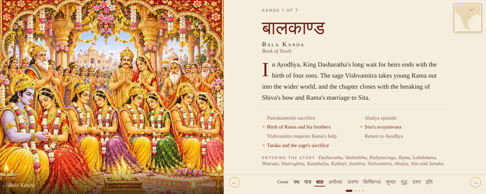
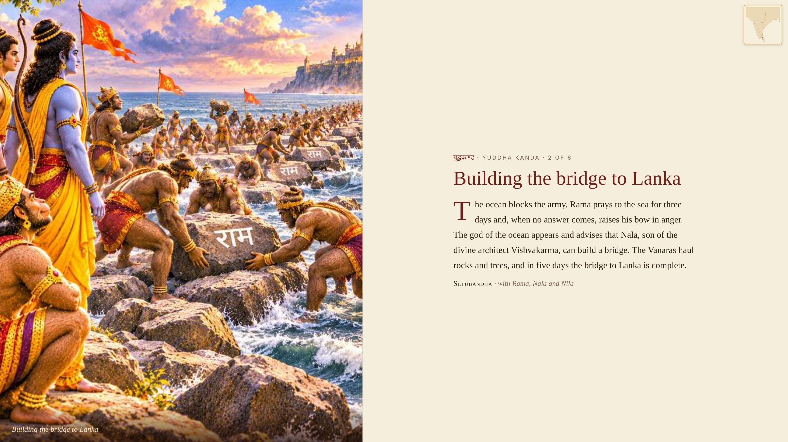

# रामायण · Ramayana Storybook Illustrated

An illustrated, storytelling **Tableau data app** that tells the Valmiki Ramayana through its seven Kandas (बालकाण्ड to उत्तरकाण्ड). Each page fits one screen: an illustration on the left and the story on the right. The data is read live from a Tableau published data source.



## What's inside the story
- **Cover and the Path of Rama:** a map of the 12 traditional stops from Ayodhya to Lanka and back, with a "trace the journey" animation
- **Who's who (पात्र परिचय):** the main characters of the four worlds (Ayodhya & Mithila, Kishkindha, Lanka, Sages & Forest)
- **7 Kanda chapters:** each has its real Kanda name in Devanagari, an introduction, all its episodes, and the characters who enter the story there
- **24 key moments told in detail:** for example the war with Khara and Dushana, Kumbhakarna, Lakshmana and Meghnad, and Rama and Ravana
- **Closing page, resume-reading,** and a small locator map on every page



## Architecture
```
data/raw (starter CSVs)
   └─ pipeline/build_curated.py   curate: FK fixes, provenance, key-moment narration, map coordinates
   └─ pipeline/validate.py        dbt-style data tests (keys, relationships, accepted values, ASCII-safety)
   └─ pipeline/build_union.py     one CSV → Tableau published data source "Ramayana_Story_Data"
   └─ pipeline/build_snapshot.py  bundled fallback copy (app/…/src/data.js)
   └─ pipeline/build_map.py       coastline silhouette from Natural Earth (no political borders)
   └─ pipeline/prepare_images.py  resize + register illustrations
app/   Tableau data app (viz extension): .twb + extension package (HTML/CSS/JS, no external origins)
```
- **Live data:** the app queries the published source through the Tableau Extensions API (`queryAsync`), splits rows by `Record Type`, and joins them in JavaScript. If the live query fails, it falls back to the bundled snapshot.
- **No-scroll layout:** a zoom-to-fit routine keeps every page inside short Tableau frames. This is tested at 1100×520 up to 1440×900.

## Run it
- **Tableau Cloud:** publish `dist/Ramayana Storybook Illustrated.twbx`. The site needs the published data source `Ramayana_Story_Data` (upload `data/curated/Ramayana_Story_Data.csv`).
- **Note:** Tableau data apps are a Cloud-only (beta) feature. They don't render in Tableau Desktop or on Tableau Public.
- **Local tests:**
  ```bash
  python3 pipeline/build_curated.py && python3 pipeline/validate.py
  node test/storybook_test.js "$(python3 test/build_union_harness.py app)" /tmp/shots
  ```

## Notes on the content
- Texts are short **paraphrases** of the Valmiki Ramayana, not translations. Key-moment narration lives in `pipeline/story_content.py` for review.
- Places are **traditional associations**, placed approximately. They are not claims of historical geography.
- Illustrations are AI-generated.
